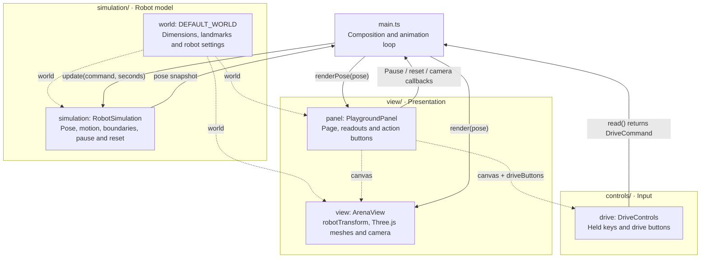

# Episode 001 · A world for the robot

Status: draft for recording. Language: English.

Commit: `tutorial(ep-001): introduce the robot world`.
Checkpoint: `slam-ep-001`.
Format: screen recording of the playground, followed by a short code tour.

## Opening · Show the world

Before we can explore how a robot finds its way, we need somewhere for it to move.

Here is our world. The floor is sixteen meters wide and twelve meters deep. Each grid square is one meter across. The small wheeled body in the middle is our robot. The six labeled markers are landmarks. They stay in the same places while the robot moves.

The scene has a little height, which makes the robot and markers easier to see. The robot's motion is still two-dimensional. It travels across the floor and turns on that floor.

## Drive · Focus the canvas and move

Click the world, then hold W to move forward. S reverses. A turns left, and D turns right. The arrow keys do the same job, and the buttons beside the scene let us drive with a pointer or a touchscreen.

Watch the nose of the robot. Forward means the direction it faces. Turn first, then drive again. The robot now heads somewhere else on the floor.

We can also drive and turn together. This gives us a simple way to explore the world without adding a route planner.

At the bottom, the readout shows position in meters and heading in degrees. These values come straight from the simulator. We know exactly where we put the robot. We are not estimating its position from observations here.

## Boundaries · Reach a wall

Keep driving toward an edge. The robot stops before its body leaves the floor. We constrain its center using its radius, so the full circular footprint stays inside the world.

Now turn and drive back into the room. The wall stops outward motion, but it does not stop the robot from turning.

The landmark markers are visual references. Their positions stay fixed, and the robot can pass through them. For this experiment, only the outside boundary constrains motion.

## Camera · Pause and change the view

Pause the simulation and drag the scene. The camera moves around the world. Right-drag pans, and the scroll wheel zooms. The robot's position and heading remain unchanged.

Switch to the top view. The flat motion is easier to read from above. Switch back to the perspective view, and the shapes become easier to recognize. Both cameras show the same state.

This distinction matters. A camera movement changes what we see on screen. A driving command changes the robot's pose in the world.

Reset returns the robot to its starting position and heading. If we reset while paused, it stays paused. We can inspect that starting pose before driving again.

## Code tour · Show the responsibility boundaries

The whole application lives in projects slash robot-world. Its dependencies, build commands, source code, and tests stay together. The episode folder contains the lesson guide, and this voiceover gives us a script for recording it.

Inside the application, the simulation code defines the floor, landmarks, and robot motion. It uses ordinary TypeScript values. It can run without creating a canvas or a Three.js scene.

Start the code tour with robot-state, world, and robot-simulation. These files define what the robot knows about its state and how that state changes. Their comments explain the units, heading convention, motion calculation, and boundary constraints.

The controls translate held keys and buttons into a drive command. The view turns the simulation pose into a mesh position and orientation. Three.js draws those meshes and manages the camera. On a narrow screen, the camera opens its field of view so the floor still fits.

The application entry point connects those pieces. On each animation frame it reads the command, updates the simulator, and displays the resulting state. Page elements and readout formatting belong to the view. After a long browser stall, the simulator limits the amount of motion in one update so the robot does not jump across the room.

The tests exercise motion and input handling without a GPU. They also check the conversion into the rendered pose, so a sign error cannot silently make the picture disagree with the simulator.

## Closing · Return to the scene

We now have a robot, a bounded world, fixed landmarks, and a camera we can move independently. Drive around and compare the two views. Keep an eye on which actions change the robot and which actions change only the picture.

The exact simulator state gives us a reference for the experiments we build on this world.

## File-to-capability map

### Robot world structure

Use this diagram during the code tour. The node names match the objects created in `projects/robot-world/src/main.ts`. Solid arrows show runtime calls and returned values. Dashed arrows show constructor inputs.

Follow one animation frame. `main.ts` calls `drive.read()` to obtain a `DriveCommand`, advances the simulation, then sends the same `RobotPose` snapshot to the scene and the page readout. The drive controls keep their held-key set internally. The panel supplies the canvas and HTML drive buttons when those controls are constructed.

Page actions also pass through `main.ts`. It clears held input and calls `simulation.togglePause()`, `simulation.reset()`, or `view.setCamera()`, then updates the corresponding panel display. Orbit, pan, and zoom stay inside the view. The model owns the robot's state; the presentation reads that state and displays it.

### Learner code map

Use this table during the code tour. The simulation files are where we develop robot behavior. The view consumes their values and draws the result.

| File in `projects/robot-world/`                                                                  | What the learner should understand                                                                                                                         | Study priority                                                                                    |
| ------------------------------------------------------------------------------------------------ | ---------------------------------------------------------------------------------------------------------------------------------------------------------- | ------------------------------------------------------------------------------------------------- |
| `src/simulation/robot-state.ts`                                                                  | `RobotPose` represents position in meters and heading in radians. `DriveCommand` expresses forward motion and turning without referring to keys or meshes. | Essential: the state and command contracts.                                                       |
| `src/simulation/world.ts`                                                                        | World dimensions, landmark coordinates, robot radius, speeds, and starting pose are simulation data.                                                       | Essential: the environment and physical settings.                                                 |
| `src/simulation/robot-simulation.ts`                                                             | A command and elapsed time produce the next pose. Trace heading, translation, wall limits, pause, and reset.                                               | Essential: robot behavior and its mathematical rules.                                             |
| `src/main.ts`                                                                                    | Read a command, update the simulation, then render its pose. Application actions connect these components.                                                 | Understand the short animation loop and connections.                                              |
| `src/view/robot-transform.ts`                                                                    | Translate the simulator's planar x/y coordinates into Three.js x/z coordinates. This adapter describes rendering axes.                                     | Understand the boundary between state and drawing.                                                |
| `src/controls/drive-command.ts`                                                                  | Convert held key codes into `forward` and `turn`, including simultaneous and opposing keys.                                                                | Understand how input becomes a simulation command.                                                |
| `src/controls/drive-controls.ts`                                                                 | `keydown` remembers held keys, `keyup` releases them, and `read()` produces the command for the next update.                                               | Read the input flow; focus and pointer cleanup are supporting browser code.                       |
| `src/view/arena-view.ts`                                                                         | `render(pose)` applies the converted position and orientation to the robot mesh.                                                                           | Read `render()`; mesh shapes, materials, lighting, and camera setup are supporting graphics code. |
| `src/view/playground-panel.ts`, `src/view/camera-framing.ts`, `src/view/style.css`, `index.html` | Display readouts and controls, fit the camera, and arrange the page.                                                                                       | Optional for understanding robot behavior.                                                        |

Keep robot geometry and coordinate calculations in `simulation/` when they describe the physical model. `view/robot-transform.ts` only adapts a finished pose for drawing. The view reads simulation values; it does not calculate the robot's next state. Tests in `tests/simulation/` exercise that state without a browser or renderer.

### Checkpoint files

These files belong to the episode checkpoint named above.

| Files                                                                                                                     | Responsibility                                                                   |
| ------------------------------------------------------------------------------------------------------------------------- | -------------------------------------------------------------------------------- |
| `AGENTS.md`, `README.md`, `episodes/README.md`                                                                            | Repository navigation and project ownership conventions.                         |
| `.gitattributes`                                                                                                          | Consistent text line endings across checkouts.                                   |
| `episodes/001-robot-world/README.md`                                                                                      | Current lesson, experiments, assumptions, and verification evidence.             |
| `projects/robot-world/README.md`                                                                                          | Standalone project setup and architecture guide.                                 |
| `projects/robot-world/src/simulation/robot-state.ts`                                                                      | Rendering-independent robot pose and drive command contracts.                    |
| `projects/robot-world/src/simulation/world.ts`                                                                            | Floor, fixed landmarks, and robot settings.                                      |
| `projects/robot-world/src/simulation/robot-simulation.ts`                                                                 | Robot pose, speed-limited motion, footprint containment, pause, and reset.       |
| `projects/robot-world/src/controls/drive-command.ts`                                                                      | Held keys and aliases to drive commands.                                         |
| `projects/robot-world/src/controls/drive-controls.ts`                                                                     | Keyboard and pointer input, focus loss, release, browser shortcuts, and cleanup. |
| `projects/robot-world/src/view/robot-transform.ts`                                                                        | Planar robot pose to rendered position and orientation.                          |
| `projects/robot-world/src/view/camera-framing.ts`                                                                         | Camera field of view for narrow canvases.                                        |
| `projects/robot-world/src/view/arena-view.ts`                                                                             | World meshes, landmarks, robot, lighting, camera controls, and resize handling.  |
| `projects/robot-world/src/main.ts`                                                                                        | Animation loop and connections between controls, simulation, and view.           |
| `projects/robot-world/src/view/playground-panel.ts`                                                                       | Page actions, pose readout, status, camera buttons, and startup fallback.        |
| `projects/robot-world/src/view/style.css`, `projects/robot-world/index.html`                                              | Responsive layout and accessible controls.                                       |
| `projects/robot-world/tests/simulation/robot-simulation.test.ts`                                                          | Motion, boundaries, pause/reset, time handling, and invalid commands.            |
| `projects/robot-world/tests/controls/drive-command.test.ts`, `projects/robot-world/tests/controls/drive-controls.test.ts` | Command combinations and DOM input lifecycle.                                    |
| `projects/robot-world/tests/view/robot-transform.test.ts`, `projects/robot-world/tests/view/camera-framing.test.ts`       | Simulation-to-view agreement and responsive camera coverage.                     |
| `projects/robot-world/tests/view/playground-panel.test.ts`                                                                | Real page connections, read-only pose display, actions, cleanup, and fallback.   |
| `projects/robot-world/package.json`, `projects/robot-world/package-lock.json`                                             | Standalone project commands and reproducible dependencies.                       |
| `projects/robot-world/tsconfig.json`, `projects/robot-world/tsconfig.simulation.json`, `projects/robot-world/.gitignore`  | Strict project and browser-free simulation checks; ignored generated files.      |
| `voiceovers/001-robot-world.md`                                                                                           | Conceptual narration for this checkpoint.                                        |
